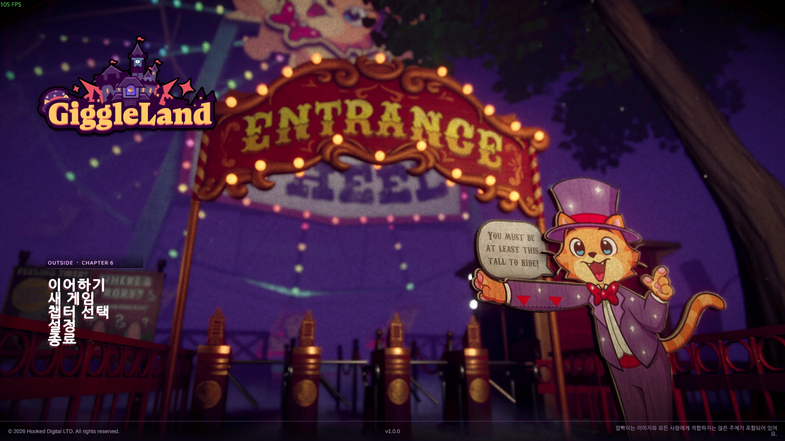
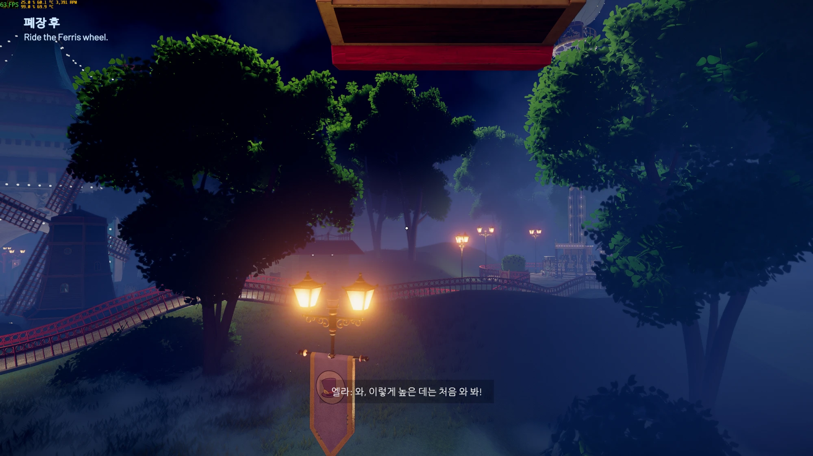
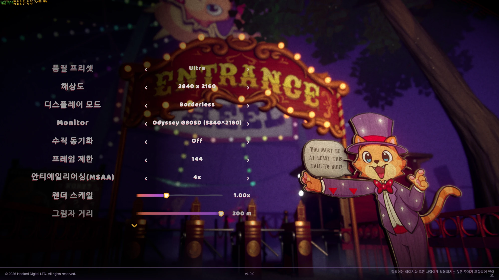

# Giggleland 한국어 패치 (비공식)

Steam 게임 **Giggleland**(영어 단독)를 한국어로 바꾸는 비공식 팬 패치입니다. 게임 데이터 파일 몇 개(`resources.assets`와 `level` 씬)를 교체하는 방식입니다.

> 팬이 만든 비공식 패치입니다. 개발사·배급사와 무관하며, "Giggleland" 및 관련 상표는 각 권리자의 것입니다.

---

## 미리보기

패치 적용 후 메뉴·인게임 자막·설정 화면이 한글로 표시됩니다.

|  |  |  |
|:---:|:---:|:---:|
| 메인 메뉴 (이어하기·새 게임·챕터 선택·설정·종료) | 인게임 자막·목표 | 설정 옵션 (수직 동기화 등) |

---

## 준비물

- Windows PC
- Steam 정품 Giggleland (이 패치는 게임을 포함하지 않습니다)

## 설치

1. 게임을 완전히 종료합니다(Steam 오버레이 포함).
2. [Releases](../../releases) 에서 `Giggleland-KR-v1.1.zip` 를 다운로드합니다.
3. 게임 데이터 폴더를 엽니다: Steam → 라이브러리 → Giggleland 우클릭 → 관리 → **로컬 파일 보기** → `Giggleland_Data` 폴더.
   - 예: `C:\Program Files (x86)\Steam\steamapps\common\Giggleland\Giggleland_Data`
   - 다른 드라이브(`D:\SteamLibrary\...`)에 설치했어도 "로컬 파일 보기"로 열립니다.
4. **원본 백업(권장)**: 되돌릴 때를 대비해 `Giggleland_Data` 폴더를 통째로 복사해 두세요. (백업을 안 해도 Steam **파일 무결성 검사**로 원본 복원이 가능합니다.)
5. 받은 zip을 풀어 나온 파일들(`resources.assets`, `level0`~`level13`)을 `Giggleland_Data` 에 **덮어쓰기**합니다.
6. 게임을 실행합니다.

바뀌는 파일: `resources.assets`(텍스트·폰트)와 `level0`~`level13`(메뉴·UI). `.resS` 등 나머지는 건드리지 않습니다.

## 되돌리기

- 백업해 둔 원본 파일들을 `Giggleland_Data` 에 되돌려 놓습니다.
- 또는 Steam → Giggleland → 관리 → 설치된 파일 → **파일 무결성 검사**(백업이 없어도 원본 복원).

## 파일 검증

- `resources.assets` 는 Unity 엔진의 에셋 컨테이너(데이터 파일)입니다. 게임 실행 코드는 이 파일이 아니라 `GameAssembly.dll` 에 있습니다.
- [AssetRipper](https://github.com/AssetRipper/AssetRipper) 또는 [UABEA](https://github.com/nesrak1/UABEA) 로 열면 `LocalizationData`(번역표)의 한국어 텍스트와 폰트 에셋의 한글 글리프를 볼 수 있습니다.
- 원본과 비교하려면 무결성 검사로 원본을 복원해 바이너리 비교(diff)하면 됩니다.
- 바뀐 애셋의 종류와 제작 과정: [`docs/HOW_IT_WORKS_KO.md`](docs/HOW_IT_WORKS_KO.md).

## 알려진 한계

- **CONTENT WARNING**(게임 첫 시작 스플래시)과 일부 연출 문구·목표 부제는 코드나 특수 구조(스플래시 `steps` 배열 등)에 들어 있어 이 버전에서는 영어로 남습니다.
- 사람 이름(CCTV/NPC)·키 표시·구역 코드는 게임 기능 보호를 위해 일부러 원문(영어)으로 둡니다.
- 번역표에 없는 항목, 그리고 인트로/로딩 영상이나 이미지에 그림으로 박힌 글자는 바뀌지 않습니다.
- 게임 업데이트가 교체 파일을 되돌리면 다시 덮어써야 합니다.

## 저작권 / 주의

- 정품 보유자 전용입니다. 이 패치 파일들은 게임 원본 애셋을 포함하므로 **재배포(재업로드)를 금지**합니다.
- 번역문은 팬 제작물이며, 게임과 애셋의 저작권은 개발사(Hooked)에 있습니다. 한글 글꼴은 나눔고딕(SIL Open Font License)입니다.
- 이 저장소는 유지보수·지원하지 않으며, 버그 리포트·이슈를 받지 않습니다. 필요하면 자유롭게 **포크**해 가져가 고쳐 쓰고 유지보수해도 됩니다.
- 개발사가 배포 중단을 요청하면 따릅니다.
- "있는 그대로" 제공되며 사용 책임은 사용자에게 있습니다. 세이브는 미리 백업하세요.
